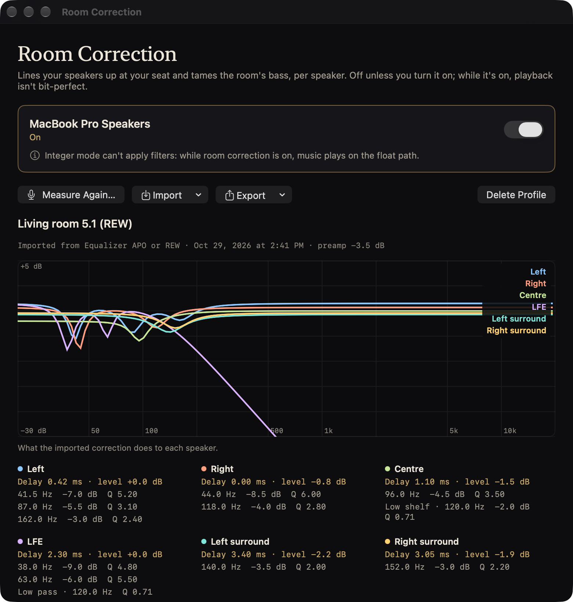

<p align="center">
  <picture>
    <source media="(prefers-color-scheme: dark)" srcset="docs/brand/logo.svg">
    
  </picture>
</p>

<p align="center">
  <strong>The free, open-source Mac player for surround and hi-res music collections.</strong>
</p>

Vespertine plays your stereo and surround music from one library: SACD images, DVD-Video discs, DTS CDs, Dolby TrueHD, DTS-HD Master Audio, Atmos and plain FLAC. It plays surround as head-tracked Spatial Audio on AirPods, measures your room with a USB microphone and corrects each speaker, shows every step between the file and your DAC, and tells you whether your "hi-res" files really are.

<p align="center">
  <a href="https://github.com/szeremeta1/Vespertine/releases/latest"><strong>Download the DMG</strong></a> or <code>brew install --cask szeremeta1/tap/vespertine</code> · macOS 14.4+ · Apple silicon and Intel<br>
  Signed and notarized · no account, no telemetry · <a href="https://vespertineapp.com/">Website</a> · <a href="https://vespertineapp.com/press.html">Press kit</a> · <a href="https://vespertineapp.com/privacy.html">Privacy</a> · <a href="https://github.com/sponsors/szeremeta1">Sponsor</a>
</p>

<p align="center">
  <a href="https://github.com/szeremeta1/Vespertine/releases/latest"></a>
  <a href="https://github.com/szeremeta1/Vespertine/actions/workflows/ci.yml"></a>
  <a href="LICENSE"></a>
</p>

<p align="center">
  <a href="https://u24.gov.ua/"></a><br>
  <sub><strong>Vespertine stands with Ukraine.</strong> Please donate through <a href="https://u24.gov.ua/">United24</a>, <a href="https://savelife.in.ua/en/donate-en/">Come Back Alive</a> or <a href="https://www.razomforukraine.org/donate/">Razom for Ukraine</a>, or see <a href="https://stand-with-ukraine.pp.ua/">more ways to help</a>.</sub>
</p>

<p align="center">
  
</p>

## Highlights

- **Room correction, measured in your room.** Measure with a UMIK-1 or another calibrated USB microphone at one to five spots around your seat, and Vespertine fits filters to each speaker and lines up their delay and level. Stereo and 5.1. It also imports REW and Equalizer APO filters and impulse responses. Off by default and bit-perfect while off. [More below](#room-correction).
- **Stereo and surround in one library.** SACD 5.1, multichannel FLAC, DTS CDs, TrueHD and DTS-HD MA sit next to your stereo albums. When an album has both versions, each song is listed once and Vespertine plays the one that suits your output.
- **Disc images, played directly.** SACD `.iso` images (stereo and multichannel, DST or plain) and DVD-Video LPCM (`.iso` or a `VIDEO_TS` folder) play straight from the image, with nothing mounted or extracted. It matched sacd_extract bit for bit on two real discs.
- **Spatial Audio for your own files.** Local surround plays as head-tracked Spatial Audio on AirPods, with Atmos objects rendered from Dolby Digital Plus. Surround can also be exported as binaural stereo or multichannel ALAC.
- **A signal path you can check.** Decoding, resampling, mixing, gain and output format are shown for every track, read back from Core Audio. BIT-PERFECT appears only when the [conditions in code](Packages/VespertineKit/Sources/VespertineAudio/SignalPath.swift) are met, and when something changed the samples it says what. A built-in [loopback test](docs/LOOPBACK.md) checks the software path sample by sample.
- **Native DSD.** DSF and DSDIFF from DSD64 to DSD512, including DST-compressed files, go out as DoP to DACs that take it, or convert to high-rate PCM.
- **Fake hi-res detection.** Flags 16-bit audio padded to 24, likely upsampled masters and likely lossy sources, with the measurements behind each verdict. `vespertine-analyze` runs the same analysis on a Linux server next to your files.
- **Speaks your language.** English and 44 more, from Ukrainian and Japanese to Amharic and Tamil, with right-to-left layouts for Arabic, Hebrew, Persian and Urdu and separate Simplified, Traditional and Hong Kong Chinese. A check on every change confirms each string exists in every language with matching placeholders and plural forms, and every screen was reviewed in every language for clipped or overlapping text. Corrections from native speakers are welcome.

<p align="center">
  
</p>

## Room correction

Measure your room with a UMIK-1 (or another calibrated USB microphone) from one to five listening spots. Vespertine plays sweeps through one speaker at a time and designs filters for each speaker from the measurement. They are cut-dominant: they take down the room's peaks and boost broad dips only gently. The same measurement sets each speaker's delay and level, so they all reach your seat together and at the same loudness.

- **Targets:** Warm (the default), Gentle tilt or Flat, for the bass only or the full range. Change the target and redesign the filters without measuring again.
- **Import and export:** REW and Equalizer APO filters (each speaker's delay, level and filters) in, Equalizer APO text out. Impulse responses (WAV, AIFF, CAF or FLAC) play by convolution.
- **Stereo and 5.1.**
- **See the change:** the Room Portrait shows the speakers, your seat and each microphone spot as it's measured, and the Curve Reveal turns the measured response into the predicted one. A before/after switch compares them. "After" is predicted, not measured.
- **Off by default.** Playback is bit-perfect while it's off. While it's on, the signal path says ROOM CORRECTION.

<p align="center">
  
</p>

[How room correction works](docs/ROOM-CORRECTION.md)

## Everything else

- **Output:** Switches your DAC to each file's sample rate, with exclusive (hog) mode, integer mode and an option to send 16-bit files as 16-bit. Remembers your DAC and falls back to the best connected output when it's unplugged. Lossless 24-bit / 48 kHz on AirPods Max over USB-C.
- **EQ:** A 20-band parametric EQ that imports AutoEQ and Equalizer APO presets per output. It's off by default, and when it is on the signal path says EQUALIZER.
- **Library:** Albums, artists, songs and genres with combinable filters, smart playlists in units like 24-bit and 88.2 kHz, gapless CUE-sheet albums, and favorites. Imports M3U and Apple Music playlists, play counts and favorites.
- **Metadata:** A tag editor that backs up every file before writing, with MusicBrainz and cover art lookup.
- **Network shares:** SMB, NFS and WebDAV, with caching and Keep Offline. Library scans step aside for the song you're playing.
- **Everyday:** Mini player, menu-bar extra, media keys, an optional Discord status with cover and format, ReplayGain, a short setup assistant and automatic updates.

**Formats:** FLAC, ALAC, WAV, AIFF, DSF, DSDIFF, SACD ISO, DVD-Video LPCM, Dolby Digital, Dolby Digital Plus with Atmos, Dolby TrueHD, MLP, DTS, DTS-HD MA, DTS CDs, APE, WavPack, TTA, Opus, Vorbis, Musepack, MP3 and AAC, plus CUE sheets.

[All features, formats and screenshots](docs/FEATURES.md)

## Compared with other Mac players

Bit-perfect playback is available in several Mac players. Vespertine focuses on a surround collection, a signal path you can inspect, and GPL source you can audit. Here's what each player's own documentation or source code says. "Not documented" means the vendor doesn't say either way; it is not a claim that the player lacks the feature.

| | Vespertine | Apple Music (Mac) | Audirvana Studio / Origin | Roon | VeraVox | Colibri | Cog | foobar2000 for Mac |
|---|---|---|---|---|---|---|---|---|
| Source code | GPL-3.0 | Closed | Closed | Closed | Closed | Closed | GPL-2.0 | Closed |
| FLAC / DSD files | Yes / Yes | No / No | Yes / Yes | Yes / Yes | Yes / Yes | Yes / Yes | Yes / Yes | Yes / No⁴ |
| Automatic DAC rate switching | Yes | No | Yes | Yes | Yes | Yes | Yes | Not documented |
| Exclusive (hog) mode | Yes | No | Yes | Yes | Yes | Yes | Yes | Yes |
| 16/24-bit PCM without sample changes | Conditions + tests | macOS 27: third-party tests¹ | Vendor claim | Vendor claim | In-app loopback test | Vendor claim | In-app indicator | Not documented |
| Local surround files | Yes² | Not documented | Yes | Yes | Yes | Not documented | Yes | Not documented |
| Apple Spatial Audio for local surround | Yes | Catalog Atmos only³ | Not documented | Not documented | Not documented | Not documented | Yes | Not documented |
| Hi-res file analysis | Yes | No | AudioScan | Dynamic range, loudness | Yes | Not documented | No (live spectrum only) | No (live spectrum only) |
| SACD ISO | Yes | No | Yes | No (DSF/DFF only) | Yes | No | No | No⁴ |
| Room correction | Measured in the app (USB mic), or REW / APO and impulse-response import | No | Via convolution (Origin: paid option) or Audio Units | Via convolution | No (by design) | Not documented | No | Not documented |
| Convolution / audio effect plugins | Yes (room correction) / No | No / No | Yes (Origin: paid option) / Audio Units | Yes / No | No / No | Not documented / Not documented | No / No | Not documented / Audio Units |
| Streaming services | No | Apple Music | Studio: yes; Origin: no | Yes | No (local + UPnP) | No (internet radio) | No (internet radio) | No (internet radio) |

¹ Apple Music on macOS 27 was bit-exact at 16/24-bit in [third-party loopback tests reported on ASR](https://www.audiosciencereview.com/forum/index.php?threads/music-app-on-macos-27-and-ios-27-finally-plays-bit-perfect.73373/). This is not a Vespertine measurement or a claim about every Mac configuration. Volume was at 100%; there is still no automatic rate switching, hog mode, FLAC or DSD on Mac. The original test report could not be independently rechecked for this update.

² Multichannel DAC output and receiver bitstream are experimental, untested on real receivers and multichannel USB DACs (one Sony TV over HDMI has been tested: see docs/DEVICES.md); reports wanted. Automated routing and carrier tests do not establish hardware compatibility.

³ Apple documents Spatial Audio with head tracking for Dolby Atmos tracks in the Apple Music catalog. It does not document spatial rendering of your own multichannel files.

⁴ Tested on foobar2000 2.26 (macOS 27.0.1), with no components: DSF, DFF and SACD ISO files fail with "Unsupported file format". DSF and DFF play only as 352.8 kHz PCM after installing FFmpeg separately and adding them to its FFmpeg Decoder Wrapper; SACD ISO still fails.

[Comparison sources and scope](docs/COMPARISON.md). Corrections welcome: [open an issue](https://github.com/szeremeta1/Vespertine/issues).

## Known limitations

PCM playback has been tested up to 768 kHz and DSD256 on a Fosi Audio ZD3, and up to 384 kHz and DSD128 on a FiiO K11. Playback has also been tested on AirPods Max over USB-C and Bluetooth, MacBook Pro speakers, and a Sony TV over HDMI in 5.1 ([details](docs/DEVICES.md)). [Device reports](https://github.com/szeremeta1/Vespertine/issues/new?template=dac_report.yml) help extend that.

- Channel-for-channel output is confirmed on one real device, a Sony TV over HDMI (5.1 and a 7.1 to 5.1 downmix; see [Tested devices](docs/DEVICES.md)). Multichannel USB DACs and Dolby/DTS bitstream to receivers are untested on real hardware; reports wanted.
- Intel Macs are untested (the Intel build has run under Rosetta). DoP is confirmed up to DSD256 on the Fosi Audio ZD3 and up to DSD128 on the FiiO K11; DSD512 over DoP is untested on hardware.
- No audio effect plugins, streaming services or UPnP/DLNA. Convolution is only part of room correction.
- No DVD-Audio, DSD inside WavPack or DRM-protected Apple Music downloads. TrueHD Atmos and DTS:X objects are not rendered, and TrueHD and DTS-HD MA receiver passthrough is unsupported on macOS.

## Building

You need Xcode and XcodeGen (`brew install xcodegen`):

```bash
scripts/generate-project.sh && open Vespertine.xcodeproj
```

Run the tests with `swift test` in `Packages/VespertineKit` and `Packages/VespertineAnalysis` (the analysis core also builds on Linux), or `scripts/audit.sh` for everything. [docs/DEVELOPMENT.md](docs/DEVELOPMENT.md) covers command-line builds, a synthesized demo library, and the tools for checking playback on your own hardware.

## Contributing

Bug reports, device reports and pull requests are welcome. See [CONTRIBUTING.md](CONTRIBUTING.md) and the [code of conduct](CODE_OF_CONDUCT.md).

## License

GPL-3.0-or-later. See [LICENSE](LICENSE). Third-party components and their licenses are listed in [THIRD-PARTY-NOTICES.md](THIRD-PARTY-NOTICES.md).

## Trademarks

Dolby, Dolby Atmos, Dolby Digital, Dolby Digital Plus and Dolby TrueHD are trademarks of Dolby Laboratories. DTS, DTS-HD Master Audio and DTS:X are trademarks of DTS, Inc. Apple, AirPods, AirPods Max and Spatial Audio are trademarks of Apple Inc. Vespertine names these formats and products only to describe what it plays and where. It is not certified, licensed or endorsed by Dolby, DTS or Apple, and it doesn't use their logos.

Vespertine was called Nocturne until version 0.6.0.
