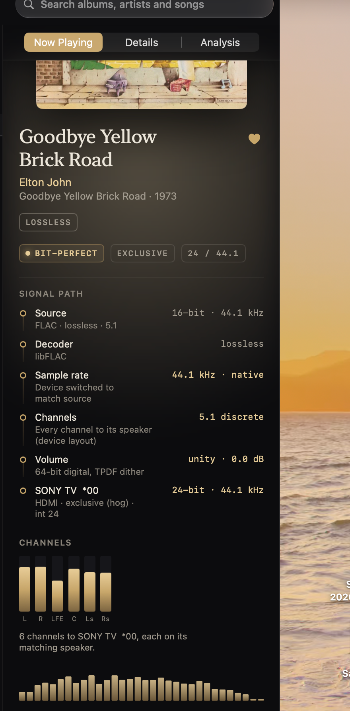
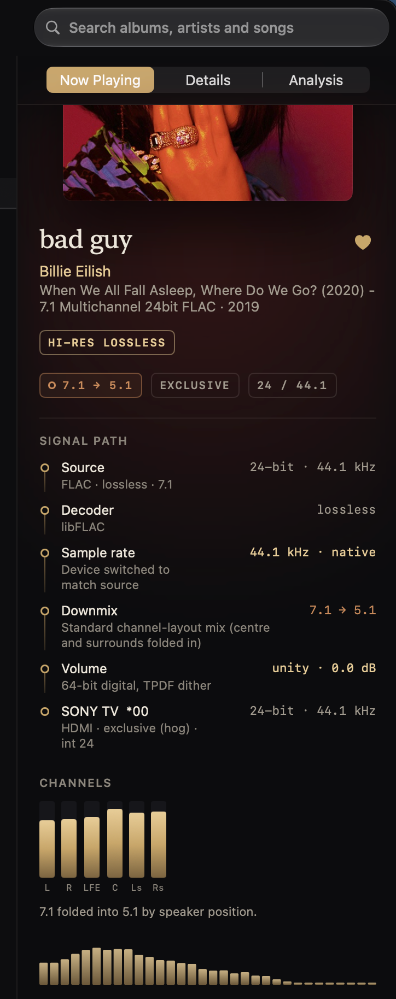
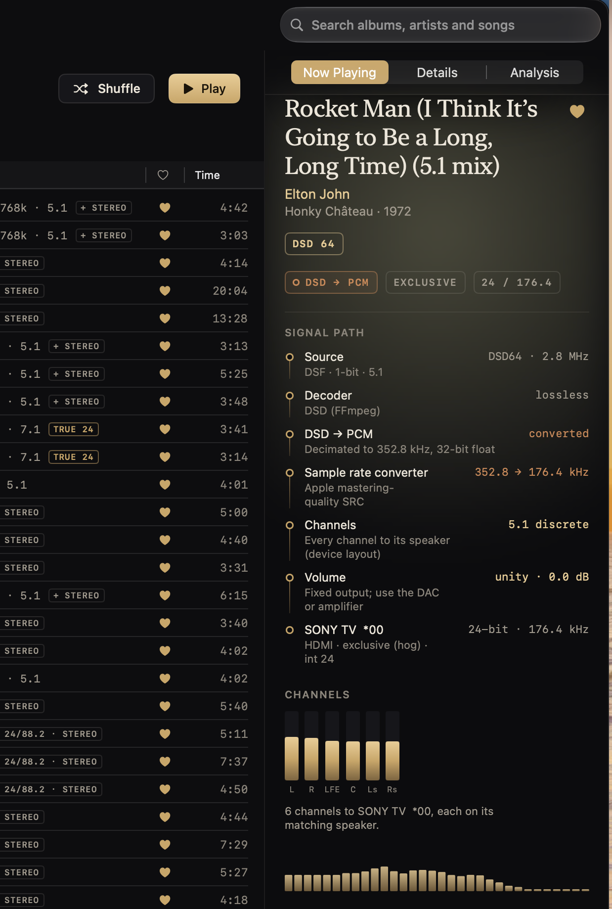

# Tested devices

What Vespertine has been run on, and what each test did and did not show. A **reported** result is one the developer observed in the app; it is not a measurement of the samples at the device unless the row says a capture was made. Reports for other hardware are welcome through the [device report form](https://github.com/szeremeta1/Vespertine/issues/new?template=dac_report.yml).

| Device | Connection | What was tested | Result | Status |
|---|---|---|---|---|
| FiiO K11 | USB | PCM at every rate to 384 kHz, DSD over DoP, 32-bit integer mode | Bit-perfect, see [VERIFICATION](VERIFICATION.md) | Tested |
| AirPods Max | USB-C and Bluetooth | 48 kHz lossless over USB-C; AAC reported over Bluetooth | As documented in [FEATURES](FEATURES.md) | Tested |
| MacBook Pro speakers | Built in | Stereo playback | Plays | Tested |
| **Sony TV (HDMI)** | HDMI, exclusive (hog) mode | **Six-channel 5.1 FLAC, 7.1 FLAC folded to 5.1, and 5.1 DSD64 converted to PCM** | **Each of the six channels went to its matching speaker position; BIT-PERFECT shown** | **Reported, 2026-10-19** |

## Sony TV over HDMI (first multichannel result)

**Setup.** MacBook Pro (Mac17,8, Apple M5 Pro, macOS 27.0), Vespertine 0.13.0, a 2018 Sony TV ("SONY TV  *00", manufacturer code SNY, product ID 0x7c04) on HDMI through a DisplayPort/HDMI connection. Exclusive (hog) mode on, volume in Vespertine at unity (0.0 dB).

**What the TV advertises** (read from its EDID, the data the TV sends the Mac):

- Linear PCM: up to 6 channels, 32, 44.1, 48, 88.2, 96, 176.4 and 192 kHz, 16, 20 and 24 bit.
- Dolby Digital and DTS: 6 channels, up to 48 kHz. Dolby Digital Plus: up to 8 channels, 44.1 and 48 kHz.
- Speaker allocation: front left/right, centre, LFE and rear left/right, so a 5.1 layout. It does not advertise 7.1.

Vespertine's output device panel showed the same facts: 6 channels, speakers L R LFE C Ls Rs, sample rates 32 to 192 kHz, bit depths 16 / 20 / 24 integer, DoP off.

**5.1 FLAC.** Elton John, "Goodbye Yellow Brick Road" (FLAC, 16-bit / 44.1 kHz, 5.1) played with the **BIT-PERFECT** badge. The signal path read: sample rate switched to match the source (44.1 kHz native), channels 5.1 discrete with every channel to its speaker, volume unity, device output 24-bit / 44.1 kHz integer over HDMI exclusive. A 24-bit / 88.2 kHz 5.1 FLAC (Fleetwood Mac, "Dreams") did the same at 88.2 kHz.

**7.1 on a 5.1 device.** Billie Eilish, "bad guy" (24-bit / 44.1 kHz 7.1 FLAC) played with a **7.1 → 5.1** badge instead of BIT-PERFECT, because the TV has no 7.1 layout. The signal path showed a standard channel-layout downmix, "7.1 folded into 5.1 by speaker position". Vespertine did not claim bit-perfect for it, which is the intended behavior.

**5.1 DSD on a PCM-only HDMI device.** Elton John, "Rocket Man (I Think It's Going to Be a Long, Long Time) (5.1 mix)" (DSF, DSD64, 5.1) played as **DSD → PCM**, not bit-perfect, and the app said so: DSD decimated to 352.8 kHz / 32-bit float, then sample-rate conversion to 176.4 kHz, delivered as 24-bit integer to the TV with every channel on its matching speaker. The TV does not accept DoP over HDMI (its audio formats are PCM, Dolby Digital, DTS and Dolby Digital Plus), so a conversion is the only way to play DSD to it.

**What this does not show.**

- No loopback or HDMI capture is recorded for this test, so it is the developer's report and the app's own signal-path readout, not a measurement of the samples at the TV. What the TV does after HDMI (speakers, processing, room correction) is outside Vespertine.
- A TV is a multichannel HDMI sink, not a multichannel USB DAC or an AV receiver. Multichannel USB DACs and receiver bitstream (Dolby Digital, DTS, Dolby Atmos in Dolby Digital Plus) remain untested on real hardware.
- One TV, one Mac, one macOS version.
