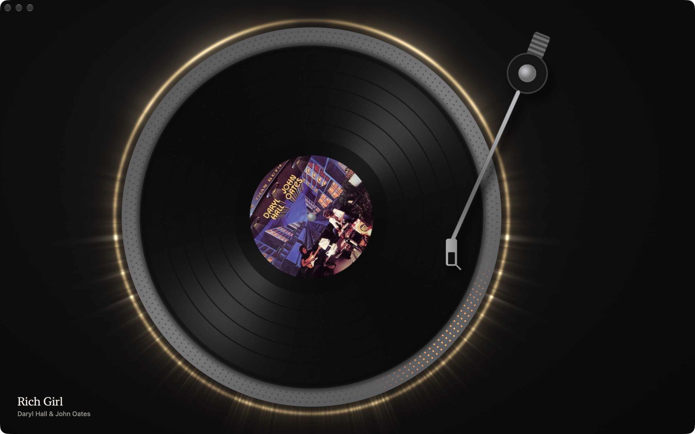
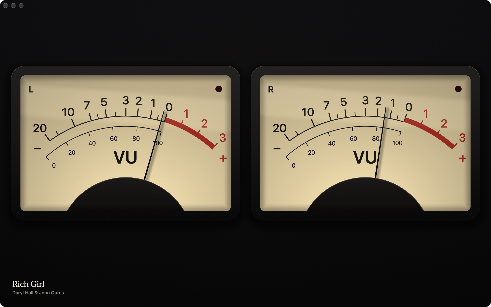
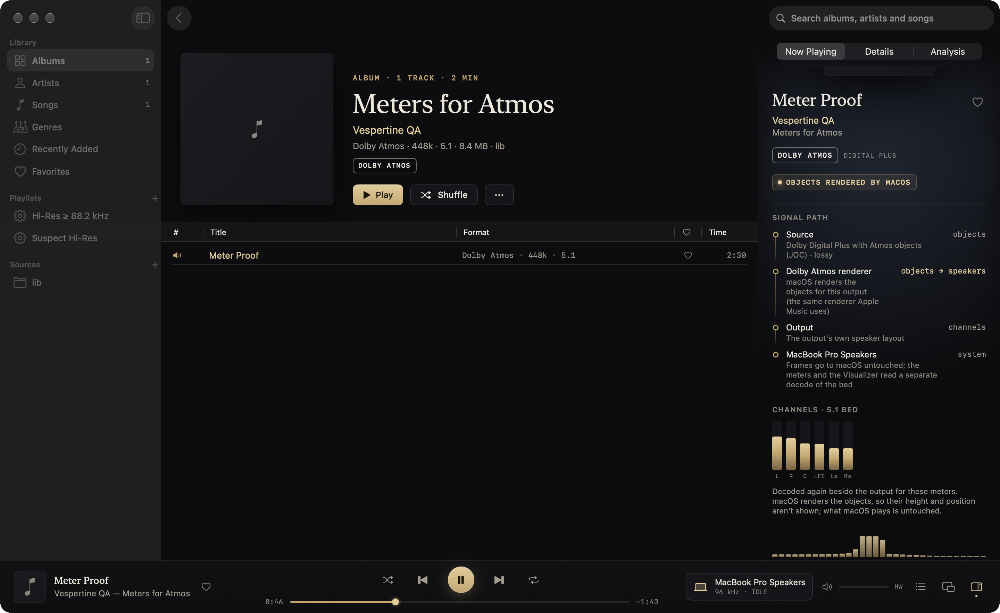
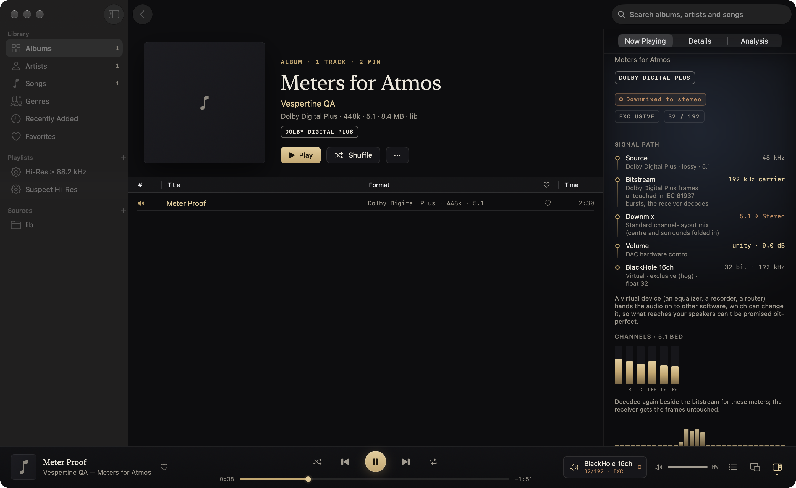
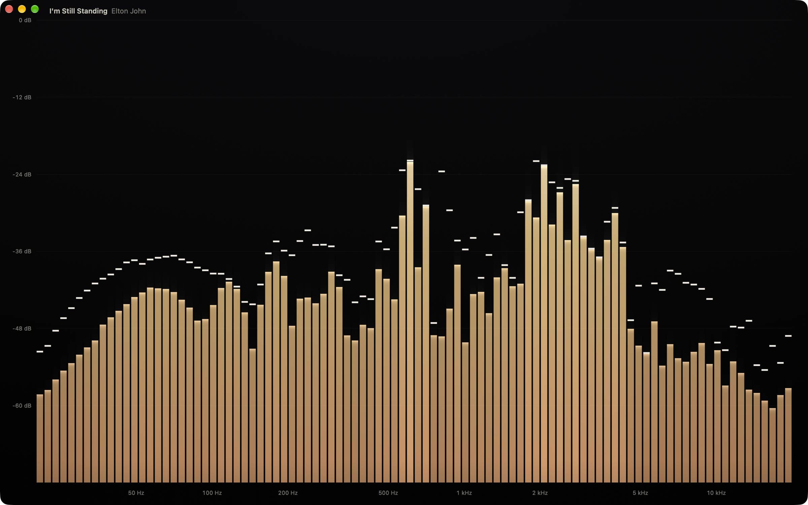
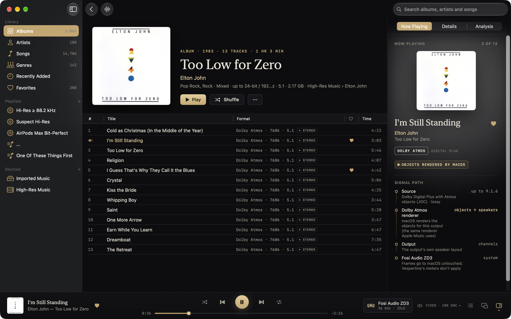

# Visualizer

An optional window that draws the music: the album on a spinning record, a bar spectrum analyzer, a scrolling spectrogram, club lights pulsing with the beat, a stereo scope, a pair of analogue VU or PPM meters, a field of particles and mirrored bars. It's off by default. Switch it on in Settings > Playback > Visualizer; then Window > Visualizer (⌥⌘V) and a toolbar button open it. The window is separate from the player, so it can sit on another display, go full screen there and keep running while the main window is minimized.

It reads a copy of what plays and never changes the sound. With the window closed, it costs nothing.





## Styles

- **Spectrum.** 32 to 128 log-spaced bands from 20 Hz to 20 kHz, smoothed (fast rise, slower fall). Heights in dB (the default: 0 dB at the top, -72 dB at the floor, a grid every 12 dB) or in linear amplitude. Three modes (Options > Mode):
  - **Classic** (the default): with held peak caps that fall away after 0.7 s.
  - **No Peaks**: the same bars without the caps.
  - **Smooth**: softer and flowing. Each band is blurred a little with its neighbours (weights 1 4 6 4 1), so the bars move together as a wave, then follows that as a critically damped spring: no snap and no overshoot, about 0.18 s to rise and 0.39 s to fall (both twice as slow with Reduce Motion), stepped exactly, so it moves the same at 60 and 120 frames a second. The bars are rounded at the top, and a curve through their tops (Catmull-Rom), with a soft veil under it, joins them into one shape. No peak caps.
- **Spectrogram.** Frequency up (log scale), time across, newest on the right. Level is brightness first (black for silence, brighter all the way up) and colour second (the theme from its mid colours to its brightest, a touch of white at the very top), so it reads the same in every theme. 6 to 30 s of history.
- **Vinyl.** The album cover as the label of a record turning at 33⅓ or 45 RPM, with grooves, the gaps between songs, a sheen that stays put while the record turns, dust that doesn't, and a platter with strobe dots under a lamp. A ring of light around the platter shows the spectrum (lows at the top, mirrored left and right). The tonearm follows the song from the lead-in to the run-out; the record spins up when playback starts and slows to a stop on pause. **Click the album cover** to move it: from the label to its sleeve **in front** of the record (the record half out of it, as when it's being taken out), to the sleeve **behind** the record (further left and turned 4°, the record lying over its right edge), and back to the label; Options > Cover picks the same three. Both places follow MD Vinyl's (measured from its screenshots): in front, the sleeve is upright and level with the record, its right edge through the record's centre; behind, it's 1.6 record radii left of the record's centre, turned 4° anticlockwise, a little in the record's shade, with the record's shadow on it. The sleeve is an LP's, a touch larger than the record, with its ring wear and its shadow. The sleeve, the record and the tonearm sit together in the middle of the window: the turntable moves right (and shrinks if it must) to make room, keeping clear of the song's title. The sleeve slides in from the left and out again. Going between in front and behind, it's pulled out clear of the record and platter in its old pose, changes sides there, and slides into its new place, turning as it goes, so it never passes through them. With Reduce Motion nothing slides or turns: the sleeve fades out where it is, the turntable moves while it's out of sight, and it fades in at its new place. A click is on the cover when it's on the label or on as much of the sleeve as shows; anywhere else (or a drag that starts on the cover) the window moves by its background, as before.
- **Club.** Two modes (Options > Mode), both moved by the beat (see [Beats](#beats)). Each beat throws a **punch**: a damped spring that jumps to about the beat's strength within a twentieth of a second and settles with one small bounce, so a hard kick moves the picture further than a soft one. **Classic**: a core like a speaker of light that swells with the bass and jumps with the punch; the spectrum round the whole of a ring about it (lows at the top, mirrored left and right, up to 9 kHz at the bottom) and thrown out across the room as rays; rings sent out by every beat; two fans of six lasers turning opposite ways (the other way every eight beats), each beam lit by its own part of the spectrum and all of them by a hit in the highs; a tunnel of rings that surges after each beat; and the whole room coming a little nearer on the beat. **Waves**: laser beams through drifting haze, fanning up from the floor and crossing down from the top corners, each with a ripple running out along it (larger the louder its own part of the spectrum, the mids and the punch), swaying on its own as the sum of two sines at unrelated rates; the fans swing open on one beat and shut on the next. Across the room run three ribbons of light, one each for the lows, the mids and the highs: each as tall as its part of the music is loud, jumping with that part's hits and running faster the louder it is. With Reduce Motion there is no punch and no zoom, the fans stay as they are, the ripples and ribbons are half the size and everything runs at a third of the speed. The optional beat strobe works in both and is described under [The strobe](#the-strobe).
- **Scope.** A phosphor screen whose trace fades as a CRT's does (a beam that moves fast leaves less light). As a **goniometer** (the default) it plots left against right turned 45°: mono is an upright line, a sound only on the left leans to the upper left, only on the right to the upper right, and out of phase lies across. A correlation bar under it reads +1 for mono, 0 for unrelated channels and -1 for out of phase (that half is tinted red). As an **oscilloscope** it shows left and right against time, about 21 ms across, each sweep starting on a rising zero crossing so the picture holds still. The crossing is looked for in left + right averaged over 2 ms, and only after the signal has been clearly negative, so hi-hats riding on a bass note don't start each sweep at a different point of it (a pure high tone, which that average cancels, triggers on the signal itself). The gain follows the music's recent peak (up at once, down over two seconds, at most +30 dB), as a scope's automatic gain does, so quiet and loud masters fill the screen alike. The goniometer's gain follows the length of the (left, right) pair, so mono and out-of-phase peaks reach the same 80 % of the circle as one channel alone. The trace leaves as much light per point in a small window or full screen on a big display as in the usual 1280 × 720 window.
- **Meters.** Two backlit analogue meters, left and right, with needles that move as the real ones do (see [Meters](#meters)). Each kind has a **Design** menu: **Original** (the default, described here) and designs modelled on real instruments (see [Meter designs](#meter-designs)). **VU** has the classic cream face, a scale linear in voltage (0 VU at 71 % of the way, the red zone to +3) and a per-cent scale under it; **PPM** is a black BBC face marked 1 to 7. A peak light (top right of each face) comes on when the needle enters the red zone, or when the signal truly clips, and stays lit for about a quarter second after. On the VU the red zone is the band from 0 VU as printed, so it follows the needle, and with it the sensitivity control; on the PPM, which prints no red, it starts at mark 6, the BBC's highest permitted peak. A true clip is a raw sample peak of -1 dBFS or more, whatever the control says, so turning it down never hides one. Side by side in a wide window, one above the other in a tall one.
- **Particles.** 20,000 particles on the GPU, carried by a flow that is the curl of a slowly changing noise field (so it never gathers them into seams or thins them out), faster with the mids. Each beat is a blast from the middle: its ring carries the particles it passes outward with it (the harder the beat, the further) and lights them, and the whole field jumps with the punch. Between beats the bass draws the field back in, so it breathes. Hits in the highs make a few particles flare, a different few each time. The field is dim between beats and follows how loud the music is, so a burst is seen. With Reduce Motion there are no blasts and the flow is calmer. Short trails, optional.
- **Mirrored.** The bar spectrum mirrored: around a **circle** (lows at the top, mirrored left and right, the album cover in the middle growing a little on the beat) or up and down from a **line** across the middle (lows at the centre). Peak caps and 32 to 128 bands as for Spectrum.

Every style has eight colour themes and a sensitivity control (a quarter to four times, logarithmic). **Vespertine**, the default, is the app's own palette (from `App/Sources/Theme/Theme.swift`, the site's tokens and `docs/brand`): obsidian surface `#16161A`, copper `#C98B5B`, brass `#C8A66A` and ivory `#ECE6DA`, dark to bright. The others are Brass, Neon, Aurora, Ember, Ice and Monochrome, and **Album Art**, which draws in the colours of the cover of whatever is playing (see [Album Art colours](#album-art-colours)). The default style is Vinyl. The style is picked from a menu in the controls; the controls fade after a few seconds without the pointer moving, and in full screen the pointer hides too. Keys 1 to 8 pick a style (in the menu's order) and Space plays or pauses.

## Album Art colours

The **Album Art** theme (Colors menu, last in the list) draws in the colours of the cover of the song playing, in every style. When the song changes the colours fade to the new cover's over 0.8 s, and an unchanged cover keeps its colours.

- **Extraction** (`AlbumArtPalette`, in `VisualizerAlbumArt.swift`). The aim is the colours a person would name looking at the cover, not the average of its pixels. The cover is drawn into a 64 × 64 bitmap. A pixel is a colour when it is far enough from grey for how dark it is (OKLab chroma of 0.035 from mid lightness up, rising to 0.09 for the darkest; nothing under a lightness of 0.13), so a near-black with a warm cast is black, not brown. Vivid pixels count for more (up to about six times a barely coloured one). The pixels are split into boxes in OKLab, always cutting the box with the most spread next, so a small patch of a different colour (a logo, a stripe) is set apart before a big field is cut finer; six rounds of k-means refine the centres. Clusters are then taken largest and most vivid first; one closer than 0.10 in OKLab to a colour already taken, or under 1.2 % of the coloured pixels, is left out, and so is a third dull one (chroma under 0.075), so wood, skin and shadow don't fill every place. The result is one to five colours, dark to bright. There is no randomness: the same cover always gives the same palette. It runs once per cover on a background task.
- **Readable.** A colour too dark to read on the background is raised to an OKLab lightness of 0.60 with its hue and its chroma kept (brought in only as far as sRGB needs), and further if its brightness (Rec. 709 weights on the sRGB values) is still under 0.30. It is not mixed with white, which would grey it.
- **Mapping.** The shaders already draw everything through one dark-to-bright gradient (bars, mirrored bars, the spectrogram's colour map, the Vinyl rim lights, the Club rings, the particles) and four role colours (surface tint, mid, accent, highlight). Album Art gives that gradient six stops: a dark tint of the cover's main colour at the bottom, then the cover's colours, each over as much of the rest as its share of the cover (at least 12 %), blending only near the joins. A cover that is mostly yellow draws mostly in yellow. A single colour runs up to a paler tint of itself. The accent is the cover's main colour, the mid colour its second, the highlight its brightest made paler.
- **Black and white.** A cover with under 3 % of its pixels in colour (black and white, sepia, white with black type) draws in its own greys: its mid grey, light grey and white, with whatever faint tint it has, so a sepia print stays warm.
- **Unchanged.** The VU and PPM peak lights and the red zone, and the scope's red tint for out-of-phase sound, are fixed colours and don't follow any theme.
- **Fallback.** No cover, or one that is all but black, draws in the default Vespertine colours, and fades back to them from a cover's. The theme's name stays selected either way.
- **Where the cover comes from.** The same picture the Vinyl label shows: the library's key for the song, else the file's own tags, the folder's image, another song of the album (`ArtworkResolver`), for local files and files on a share alike, asked again while there is none.

## The strobe

The Club style can flash the whole window on strong beats. Flashing lights can trigger seizures in people with photosensitive epilepsy, so:

- It's off by default.
- Turning it on the first time shows a warning that has to be accepted ("Photosensitivity Warning": what it does, that flashing lights may trigger seizures in people with photosensitive epilepsy, to leave it off if you or anyone watching has epilepsy or has had a seizure, and to look away and turn it off if you feel unwell). Cancel is the default action; turning it on is shown as the risky choice. Once accepted it isn't asked again (`strobeWarningAccepted`).
- The option repeats the warning: under the toggle in the visualizer's options, in its help tag, and under "Beat strobe in the Club style" in Settings > Playback > Visualizer, which has the same toggle and asks the same way.
- It never flashes while **Reduce Motion** (System Settings > Accessibility > Display) or **Dim Flashing Lights** (same place; `MADimFlashingLightsEnabled`) is on: the toggle is greyed out, shows off, and says which setting is why. With Reduce Motion on, the lasers and particles also move more calmly and beats send no ripples.
- The renderer checks all of this itself before every flash (`strobeAllowed`), and settings that say the strobe is on without the warning accepted (a hand-edited file) load with it off. Both are tested.

A flash rises in one frame and decays over about 45 ms, only on hard beats (at least 0.6 as hard as the hardest of the last few seconds: the kicks and snares that carry a song, not the notes between them), only in the Club style, and never more than one every 0.4 s: at most 2.5 a second however fast the beats come, under the 3 a second that photosensitivity guidelines (WCAG 2.3.1, the Ofcom/Harding test) allow. That's tested too, on a synthesized song played through the analysis and the renderer, down to the pixels. It's still a full-window flash 85 % of the way to white, which is why it asks first. The renderer follows the analysis's count of beats, so a beat is never missed or flashed twice however the window's frames fall against the analysis.

## Where the samples come from

```
… ▶ ring buffer ▶ HAL IOProc: room correction ▶ EQ ▶ gain + dither ▶ meters ─▶ DAC
                                                                       │
                                                                       └─ visualizer tap (copy, ÷ gain)
                                                                             ▶ analysis thread ▶ Metal
```

The tap is in the I/O proc's meter loop (`CVespertineRT`, `nrt_context_set_viz` / `nrt_context_copy_viz`), which already reads every frame after the last change to it. When the visualizer is on, each frame's left and right samples are stored into a 32,768-frame ring of its own (two relaxed atomic stores per frame, no locks, no allocation, no calls out); when it's off, the I/O thread checks one flag per slice and does nothing else. The samples going to the DAC are never read differently, written or delayed: a test renders the same input with the tap on and off and compares the output bit for bit, at unity gain and with gain.

The reader (`PlaybackEngine.copyVisualizerTap`) always takes the newest frames. Anything it didn't get to is overwritten, so a slow window drops frames rather than holding anything up. If the I/O thread laps the copy while it's being taken, the copy is thrown away (a test races the two for 4 million frames and checks that every copy kept is one moment, never two).

**Why after room correction and the equalizer.** It's what you hear: a correction or EQ curve shows in the picture. It's also in step with the sound: FIR room correction holds the output back 512 frames, and a tap before it would run that much ahead. **Why ÷ gain.** Digital volume and ReplayGain are a single gain at that point, so dividing it back out shows the music at the same size at any volume, as hardware volume (which never touches the samples) already does. At zero volume the tap reads silence.

**Modes.** Nothing about the tap depends on shared or exclusive (hog) mode: it reads the render context, not the device. In integer mode it reads the 32-bit words as integers, as the meters do. In DoP it reads the levels the meters already take from the DSD bits (good to about 20 kHz), and the DoP frames still go out untouched. Bitstream (IEC 61937) carries no PCM to look at, so it reads a second decode of the file instead, like the Atmos bed below. Atmos rendered by macOS doesn't pass through Vespertine's I/O proc either, and its output can't be read back, so the tap reads the Dolby bed instead (below). With Spatial Audio, the tap reads the decoded channels before the spatial mixer. With more than two channels it reads the front left and right.

**Atmos rendered by macOS.** `AVSampleBufferAudioRenderer` takes the compressed Dolby Digital Plus frames and gives nothing back, so there's no session and no I/O proc to tap. While a visualizer window is showing, or the main window's meters are (they are, whenever a song plays), the session decodes the same track with a second reader into the bed's own channels (`SystemBedDecoder`, Audio Toolbox's `ExtAudioFile`, never more than a second ahead of the playhead). It folds them to a stereo downmix for the picture, keeps that in a ring (`SystemBedTap`) and the visualizer reads the frames just before the renderer's playhead. The picture therefore shows the bed (the objects' height and position aren't in it), with no Spatial Audio processing, and may be a few tens of milliseconds ahead of the device's own latency. With neither showing, nothing is decoded.

**Bitstream to a receiver.** Dolby Digital, Dolby Digital Plus and DTS CDs sent untouched in IEC 61937 bursts are decoded a second time, as PCM, by the same decoder the engine uses when it isn't bitstreaming (`SystemBedDecoder(decodingWith:)`), following the position of what is playing. The receiver's own decoding delay isn't known, so the levels may run a little ahead of what it plays. The bursts go out exactly as before.

## Channel meters

The main window's channel meters and spectrum strip read Vespertine's own I/O proc, which sees nothing of macOS-rendered Atmos or a bitstream. For those they read the same side decode instead: the bed's own channels, each channel's peak per 10 ms (`SystemBedTap.takePeaks`), taken since the last read up to the playhead, so the bars move with the music. The channels are named from the file's own layout (Core Audio gives a Dolby bed as L C R Ls Rs LFE, whatever the labels say) and shown in the usual order, L R C LFE Ls Rs and on to the surround pairs and heights, under "Channels · 5.1 bed" (or 7.1, 7.1.4 …). DTS, DTS-HD, TrueHD and DTS:X files that Vespertine decodes itself already had their meters, on their own channels.

Nothing in this path touches what reaches the output: the second decode is a reader of its own on the file, and the frames macOS is handed are the same bytes with the meters on or off (`BedMeterTests.rendererInputUntouched`). The levels are those of the music before volume, ReplayGain or Spatial Audio, and don't show the Atmos objects.









## Analysis

`VisualizerAnalyzer` (in `Packages/VespertineKit/Sources/VespertineVisualizer`) runs on a thread of its own (`VisualizerFeed`, a user-interactive dispatch timer at the display's refresh rate), never on the main thread or the audio thread, and only while a visualizer window is on screen. It also stops while the window is minimized or fully covered.

- A real FFT through Accelerate (`vDSP.FFT`) of the newest 4,096 frames at 44.1/48 kHz, 8,192 at 88.2/96 kHz and 16,384 above (about 85 ms at each), with a Hann window, scaled so a full-scale sine reads 0 dB.
- 512 log-spaced bins from 20 Hz to 20 kHz: the largest FFT bin within each, or interpolated where a bin is wider than it (the lows). A +3 dB per octave tilt around 1 kHz makes typical music look level. The bars take the largest bin in each band.
- Smoothing with time constants (15 ms rise, 220 ms fall), so it behaves the same at 60 and 120 frames a second. Peak hold for 0.7 s, then a fall that speeds up.
- RMS and peak per channel over the newest 2,048 frames.
- Lows (30 to 150 Hz), mids (150 Hz to 2 kHz) and highs (2 to 16 kHz), each against its own recent loudest, so quiet and loud masters move the picture alike.
- Beats: see [Beats](#beats).
- For the scope: the newest 2,048 samples per channel (about 43 ms, thinned to about 48 kHz at higher rates) and the correlation of left and right over the same span (lightly smoothed; with either side silent it eases to 0).
- The meters (below), fed only the samples that are new since the last frame.

## Beats

`VisualizerBeatDetector` (`VisualizerBeats.swift`) finds the beats that the Club, the particles, the strobe and the smaller pulses (the Vinyl rim, the Mirrored cover) move to. It hears the samples as a stream, every one once, at its own pace whatever the display's frame rate; the feed tells it how many frames are new from the tap's own count.

- A Hann-windowed FFT of about 23 ms every 5.8 ms for the mids (180 Hz to 2.5 kHz) and the highs (to 12 kHz). The lows (32 to 180 Hz) get a spectrum of their own, of the same samples averaged down to about 5.5 kHz and four times as long (93 ms): in a 23 ms window a bass note is under two cycles and its bins swell and shrink with its phase, which would read as a beat on every held note.
- Each spectrum is read against the loudest partial of the last few seconds and compressed (log of 1 + 100 × magnitude), so a quiet master and a loud one give the same result and a kick over a held bass note still shows. It is compared with the one before: the rise in each bin above the largest of its neighbours there (so a note that only wobbles in pitch isn't a rise), summed over each band.
- A beat is a peak of the lows' and mids' rise (the highs count a little) that stands out from the last second and a half (mean plus 1.6 standard deviations), is above a fixed floor (the ripple of held notes stays under it), is at least a third of the hardest peak of the last few seconds (so the hi-hats between the kicks aren't beats, but are when nothing else plays), and comes at least 0.18 s after the last. A kick's click shows in the mids a few hundredths of a second before its body shows in the lows: the later, larger peak makes the same beat stronger rather than a second one.
- Each beat has a **strength**, 0 to 1 against the hardest of the last few seconds, and the beats are **counted**: the window draws on its own clock and may see a frame of analysis twice or never, so it compares counts and misses no beat and doubles none.
- Each band also reports its own hits (kicks; snares and plucked notes; hi-hats), 0 to 1, gone in about a tenth of a second.
- The tempo is the lag at which the last eight seconds of that rise best repeat (autocorrelation, 60 to 200 BPM; of two lags an octave apart the one nearer 126 BPM is taken, so a very fast song may read as half).
- After a pause, or when samples were lost, it starts afresh, so the join isn't a beat.

Tests use songs synthesized for the purpose (`BeatFixtures`): drums over a bass line that never stops, a backbeat with no kick drum, held chords with no beat at all, a quiet and a loud master, 44.1 to 192 kHz, 60 and 120 frames a second, uneven frames, hard and soft kicks, and a reader that sees only some frames.

## Meters

`VisualizerMeters` runs both meters sample by sample, whichever is shown:

- **VU (IEC 60268-17).** The needle is a damped mass on a spring driven by the full-wave rectified signal: damping 0.81, natural frequency 13.42 rad/s. That gives the standard's ballistics: 99 % of the reading 300 ms after a tone starts, with 1.3 % overshoot (the standard asks for 1 to 1.5 %). The needle rests against a pin at the left and pegs against one past +3 VU.
- **PPM (IEC 60268-10 Type IIa, the BBC meter).** A rectifier that charges with a 2.76 ms time constant, so a 10 ms burst reads 2 dB under a steady tone, and falls 24 dB in 2.8 s. The scale is the BBC's: marks 1 to 7, 4 dB apart, PPM 4 at the reference.
- **Reference.** A sine whose RMS is the reference level reads 0 VU and PPM 4. It's **Automatic** by default: 1 dB over the music's loudness over the last few seconds (silence between songs doesn't count), so a quiet 1960s master and a loud modern one both swing around the top of the scale. Fixed references of -20, -18 (EBU R68 alignment), -14 and -10 dBFS are in the options. The sensitivity control moves it too (twice the sensitivity is a reference 6 dB lower).

Tests check the calibration (0 VU and -10 VU), the 300 ms and the overshoot, the needle falling back and pegging, PPM 4 for a steady tone, the 10 ms burst at -2 dB, the 24 dB fall in 2.8 s, the scale, and that the automatic reference reads a quiet and a loud tone alike.

Unit tests check sines land in their own bins at 44.1 to 192 kHz, the level calibration, sensitivity, the linear scale, silence (no NaNs, no beats), peak hold, that paused audio falls away, kicks at 120 BPM found one by one at 60 and 120 frames a second with the tempo, and a steady tone with no beats. The beat tests are listed under [Beats](#beats).

## Meter designs

Besides the original pair, each meter has designs modelled on real instruments, picked from **Design** in the options (saved separately for VU and PPM). Every one keeps its standard's ballistics: the VU designs use the VU needle above unchanged, and each PPM design uses the type its scale belongs to. The research behind them (the 1940 Bell System Technical Journal paper that defined the VU meter, IEC 60268-10's types, and photographs of the instruments) is in [METER-DESIGNS.md](METER-DESIGNS.md), with links to the photographs each design was compared with.

| Meter | Design | Modelled on | Ballistics |
|---|---|---|---|
| VU | Broadcast | The 1940 standard volume indicator: a light orange-yellow Type A card (VU in black, per cent small under the arc, a red warning band past 0), black moulded cases on a grey hammer-finish panel | VU |
| VU | Console | A studio console's meter bridge: amber faces lit hard from behind, thin black bezels, a slate-grey bridge with legends and peak lights | VU |
| VU | Tape Recorder | A Swiss reel-to-reel recorder of the 1960s: two small backlit meters under chrome rims, an anthracite panel with an aluminium strip, a teak case | VU |
| VU | Cassette Deck | A 1970s hi-fi cassette deck: deep wells with mirrored walls in a brushed silver front, blue scale to +1 and red to +6, peak lights, a walnut case | VU, on a scale to +6 (0 VU at half the travel) |
| PPM | BBC | The BBC's Sifam-type meter: matt black face, white bars and numerals 1 to 7, the zero adjuster under the window | Type IIa |
| PPM | BBC Stereo | The BBC's twin-needle pair: red A (left) and green B (right) on one dial, white M and yellow S on the other | Type IIa; M and S aligned M6 |
| PPM | EBU | The same movement marked -12 to +12 dB around TEST | Type IIb (as IIa) |
| PPM | DIN | German light-pointer instruments: a band of lamp light across a white scale marked -50 to +5 dB and in per cent, on a wooden desk | Type I |
| PPM | Nordic | The Sifam-type case with the Nordic scale, -36 to +12 dB around TEST | Type I |

- **Type I** (DIN, Nordic): a rectifier like Type IIa's but charging with a 1.28 ms time constant, so a 5 kHz burst of 5 ms reads 2 dB under a steady tone (IEC 60268-10's integration time), and falling 20 dB in 1.7 s. The reference (the level that reads 0 VU and PPM 4) reads TEST on the Nordic scale and -9 on the DIN scale, their alignment levels; 0 on the DIN scale is the permitted maximum. The DIN scale isn't linear in dB; its marks are placed as measured on photographs of two instruments (they agree within about 3 %).
- **M and S** (BBC Stereo): Type IIa rectifiers on (L + R) / 2 and (L − R) / 2, so the same tone in both channels reads on M as on A and B, with S at rest, and a tone in one channel reads 6 dB lower on both.
- **Balance** (Broadcast and Console): a centre-zero meter between the two VUs, reading how many dB louder one side is, ±6 dB across its scale. It reads the two VU needles and never changes them; its own needle moves with the VU's damping, and it rests in the middle when both are under about -20 VU. It and the twin needles are there to show which side is louder, which two separate needles with the standard's slow, smoothed movement make hard to see.
- These extra ballistics run only while a design that draws them is showing. The VU and Type IIa readings are exactly the same with them as without (tested).
- Tests check Type I's 5 ms and 10 ms bursts and its 20 dB fall in 1.7 s, M and S for a tone in both channels, in one and out of phase, the +6 scale's 0 VU, 300 ms and overshoot, the balance meter's readings and overshoot, every design's scale (where the reference lands), that every layout fits wide and tall windows without faces overlapping, and that the settings default to Original and fall back to it.
- The faces carry the word "vespertine" where the real maker put its name, lettered in that maker's style (no crescent; see [METER-DESIGNS.md](METER-DESIGNS.md)); the legends (LEFT, CHANNEL I, PEAK) are part of the artwork and stay in English, as on the real instruments. The peak lights work as described under Meters; the designs that have none on the real instrument (BBC, EBU, Nordic, DIN, Broadcast, Tape Recorder) don't show one. The room behind them takes the colour theme's tint; the instruments keep their own colours.
- Drawing: everything that stays still (cabinets, panels, faces, printing, glass) is drawn once into a texture whenever the window's size, the design or the theme's colours change, and while the lamps warm up for a third of a second when a design is first shown (at once with Reduce Motion). Each frame then draws only the needles, their shadows, the light band and the peak lights over it.

## Drawing

`VisualizerRenderer` draws each style as one full-window fragment shader (Metal, compiled from source when the first window opens, so the app needs no Metal toolchain to build). An `MTKView` draws at the display's own refresh rate: 120 Hz on ProMotion displays, and it follows the window to another display. Axis labels and the song's title are drawn with AppKit into a texture when they change and laid over the picture. The spectrogram keeps its history in a texture, one column per step. The record's spin, the tonearm, the beat rings and the lasers are animated on the CPU each frame and passed to the shader.

The scope and the particles draw light first: into a half-float texture the size of the window that keeps a set fraction of itself each frame (the fade, as a blend), with the new light added on top. The scope's trace is one instanced quad per step between samples, each lit as a Gaussian beam; the particles are moved by a compute kernel, then drawn as soft sprites. The style's own shader then lays that light over its background. The meters' printed faces (scale, numbers, red zone) are drawn once with AppKit into a mask texture whenever the window's size or the meter changes; the shader lights and colours them, and draws the needle, its shadow, the cover over its pivot, the peak light and the glass.

`vespertine-visualize` renders the same analysis and shaders offline from decoded audio, for stills, recordings and timing:

```bash
ffmpeg -i song.flac -f f32le -ac 2 song.f32
cd Packages/VespertineKit && swift build -c release --product vespertine-visualize
.build/release/vespertine-visualize song.f32 --rate 44100 --style vinyl --art cover.jpg --still 60 --png vinyl.png
```

Options: `--style vinyl|bars|spectrogram|club|scope|meters|particles|mirrored`, `--theme vespertine|brass|neon|aurora|ember|ice|mono|art` (`art` takes its colours from `--art`'s cover), `--spectrum classic|noPeaks|smooth`, `--club classic|waves`, `--cover label|sleeveFront|sleeveBehind`, `--cycle-cover <s>` (the cover moves on every few seconds, as a click does), `--calm` (as with Reduce Motion), `--scope goniometer|oscilloscope`, `--meter vu|ppm`, `--reference <dBFS>`, `--layout circle|line`, `--no-trails`, `--strobe`, `--frames <dir>` (every frame as a PNG), `--beats <file>` (a CSV of every frame's beat, strength, pulse, levels and tempo), and the others listed at the top of `main.swift`. It prints the GPU time and the CPU time (stepping the motion and encoding, on the main thread) per frame.

### Cost

Offline at 2560 × 1440 on an M1 Pro, 6 s at 60 frames a second each (GPU time per frame from the command buffers' own timestamps; allow a few tenths of a millisecond of noise), against a frame budget of 8.3 ms at 120 Hz:

| Style | GPU ms a frame |
|---|---|
| Vinyl (label, sleeve) | 1.8, 2.0 |
| Spectrum (Classic, Smooth) | 1.2, 1.8 |
| Spectrogram | 0.8 |
| Club (Classic, Waves) | 2.8, 3.1 |
| Scope (goniometer, oscilloscope) | 2.0, 1.4 |
| Meters | 1.3 |
| Particles | 1.3 |
| Mirrored (circle, line) | 1.5, 1.2 |

Analysis, beats and meters included, is 50 to 60 µs a frame on the CPU; stepping the motion and encoding a frame is about 0.1 ms on the main thread. Club is the dearest: every pixel works out its fans of beams, and in Waves each beam's ripple and the three ribbons.

## The window

The window remembers its display (by ID, then by name), its frame and whether it was full screen, and opens there again: on another display if its own is gone, always on screen (`VisualizerWindowState`, tested). Style, colours and options (the Spectrum and Club modes and where the Vinyl cover is included) are saved as JSON; a value from another version that can't be read falls back to its default. Settings from before the Spectrum modes, with Peak Caps switched off (it was one switch for Spectrum and Mirrored), open Spectrum in No Peaks; Peak Caps is now Mirrored's alone.
